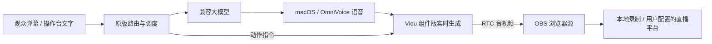

# 小沐数字人直播台

基于开源数字人引擎的本机直播控制台：聊天生成回复，语音合成后驱动数字人，通过 RTC 将画面和声音送入 OBS。当前部署适配版本为 **macos-2**。

主程序复用 [cyber-xiaoya-live](https://github.com/cyber-xiaoya/cyber-xiaoya-live) 的聊天、动作、音频调度和舞台；配套弹幕采集使用 [cyber-xiaoya-danmaku](https://github.com/cyber-xiaoya/cyber-xiaoya-danmaku)。本仓库保存本机适配源码、补丁、原创示例素材，以及基于 [ai-live-avatar](https://github.com/garycaogan/ai-live-avatar) 的旧版工作台。

**当前状态：本机原型，可安装和继续试播验证。** 已检查本机语音、页面、OBS 待机画面与离线回归；真实 Vidu 动态画面、口型、延迟和扣费尚未完成验收。默认 macOS 系统声音不代表克隆音色效果。

## 能做什么

- 使用自己的数字人图片、人设和 OpenAI 兼容大模型。
- 复用原版聊天、动作、点播、字幕和弹幕调度。
- 提供 macOS 中文语音适配，保留 OmniVoice 接口。
- 通过独立 OBS 浏览器源接收画面，控制台用于操作。
- 管理本机密钥、费用估算、单场时长、启动互斥与异常停止。
- 保留旧版素材管理与静态演练工作台。



## 安装和启动

要求 **macOS、Python 3.12+、Git、ffmpeg**，录制和直播另需安装 OBS。

```bash
git clone https://github.com/26YZT/xiaomu-live.git
cd xiaomu-live
python3 tools/install.py
```

安装器从官方仓库获取固定提交、校验并应用补丁，安装锁定依赖、校验 RTC SDK，然后创建不含 Key 的本机配置。重复运行不覆盖已有配置；上游有其他修改时会停止，不会重置你的文件。

```bash
.venv/bin/python tools/upstream_local.py start
# 停止本机主程序
.venv/bin/python tools/upstream_local.py stop
```

也可双击 `启动平台.command` / `停止平台.command`。

- 控制台：<http://127.0.0.1:8795/stage>
- 设置：<http://127.0.0.1:8795/stage?setup=1>
- OBS 专用页面：<http://127.0.0.1:8795/stage?obs=1>

## 填写自己的服务凭据

在控制台设置中填写 Vidu API Key，以及大模型的 base_url、model 和 API Key。不要把凭据写进示例文件、Issue 或提交。

| 服务 | 用途 | 当前要求 |
|---|---|---|
| Vidu S2 API | 动态数字人画面 | 自备 Key、可用权限和 API 积分 |
| OpenAI 兼容大模型 | 生成聊天回复 | 自备地址、模型名和 Key |
| macOS 系统语音 | 初始验证音色 | 默认可用，无云端语音调用 |
| OmniVoice | 可选的设计 / 克隆音色 | 自备服务与有权使用的参考素材 |

“测试大模型连接”会发起一次短请求，可能消耗大模型额度；“开始连线”会创建 Vidu 会话并计费。安装、打开页面和本机静态演练本身不创建视频会话。

## 配置 OBS

1. 打开 OBS，创建名为 **数字人私下试播** 的配置和场景集合。
2. 在“工具 → WebSocket 服务器设置”启用服务器，端口使用 `4455` 并设置密码。
3. 在终端保存同一密码，然后配置专用场景：

```bash
python3 tools/set_obs_password.py
.venv/bin/python tools/upstream_obs.py
```

脚本只在上述专用配置和集合中工作，有录制或推流时会拒绝改动。它创建 **原版小沐直播** 场景，画布为 1296×1080、30fps，浏览器源接收画面及声音。

先保持 OBS 场景打开，再从控制台连线。控制台中的静态角色图不是动态视频成功的证据，应在 OBS 检查真实画面与音轨。先录制 30–60 秒进行私下验收，再考虑正式推流。

默认单场上限 **120 秒、200 积分**，日预算 3200 积分；按保守费率估算。60 秒未收到视频帧、出画面后停帧超过 20 秒会请求停止。网络、信令和账单延迟可能造成偏差，实际费用以服务商账单为准。

## 弹幕与旧版工作台

配套采集器配置在安装后生成的 `upstream/cyber-xiaoya-danmaku/config.json`，所有平台默认关闭。填写自己的房间信息后执行 `启动弹幕采集.command`。抖音还需要额外采集服务；Cookie 只能保存在本机，不要上传。

旧版工作台保留在 `live/`、`static/` 和 `server.py`，停止原版后可双击 `启动旧版平台.command`。旧版静态演练不生成真实数字人视频。两套程序共用本机数据锁，不应同时启动。

## 验证

```bash
upstream/cyber-xiaoya-live/.venv/bin/python -m unittest discover -s upstream/cyber-xiaoya-live/local_tests -v
node upstream/cyber-xiaoya-live/local_tests/viewer.cjs
.venv/bin/python -m unittest discover -s tests -p test_upstream_launcher.py -v
```

上述 20 项后端、9 项前端、3 项启动器回归均使用本地 / 模拟环境。不要把离线测试通过等同于真实云端音画或直播平台验收。

## 源码与隐私

- [发布范围与密钥保护](docs/PUBLISHING.md)
- [本轮缺陷修复](docs/bug-audit-2026-10-28.md)
- [第三方来源及许可](THIRD_PARTY_NOTICES.md)
- [固定上游提交与补丁](vendor-patches/manifest.json)
- [源码快照校验清单](SOURCE_SNAPSHOT.json)

仓库不包含真实 `config.json`、API Key、Cookie、推流码、OBS 密码、运行账本、日志、录播或本机 Git 历史。上游原作者的人物、音色、演示视频等受限素材不在本仓库中重新分发。

代码发行遵循 [AGPL-3.0](LICENSE)，MIT 来源文件保留相应声明；素材与第三方组件遵循各自许可。本站为独立的本机适配项目，不代表原作者官方发布。
